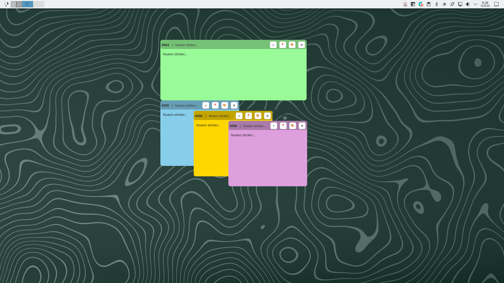
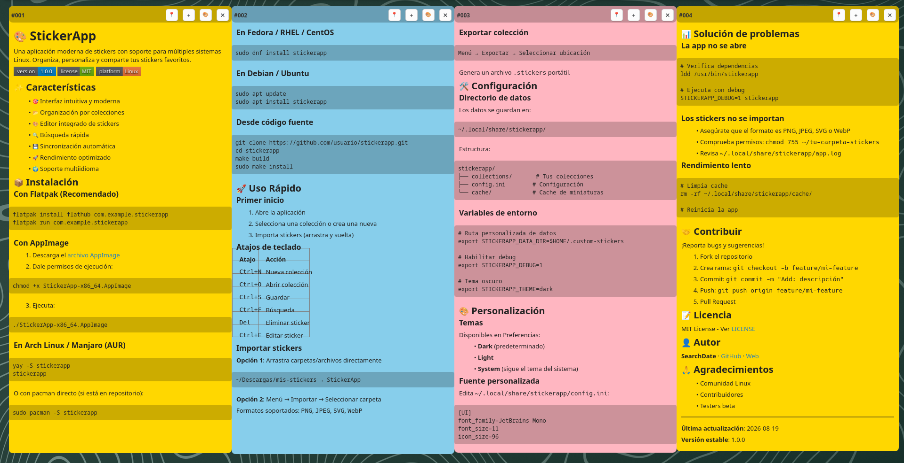

<p align="center">
  
</p>

<h1 align="center">Desktop Stickers</h1>

<p align="center">
  <a href="LICENSE"></a>
  <a href="docs/README-SP.md"></a>
  <a href="docs/README-IT.md"></a>
  <a href="docs/README-EN.md"></a>
  <a href="docs/README-DE.md"></a>
  <a href="docs/README-FR.md"></a>
  <a href="docs/README-RU.md"></a>
  <a href="docs/README-CN.md"></a>
  <a href="docs/README-JP.md"></a>
</p>

Markdown sticky notes for the KDE Plasma desktop (Wayland and X11). A
standalone Qt6/QML application (not a plasmoid) that installs like a
regular program with autostart: each sticker is an independent,
undecorated window that stacks like any other, remembers its position,
its size and whether it was open, and can be pinned to every virtual
desktop.

<p align="center">
  
</p>

## Requirements

- Plasma 6.x and KWin, Wayland or X11 session
- Qt 6.4+ (`Core`, `Gui`, `Qml`, `Quick`, `Widgets`, `DBus`)
- CMake, Bash

## Highlights

- Independent, draggable and resizable windows, with position and size
  persisted through KWin window rules; they stack like any other window
  (they don't stay always on top)
- Each sticker remembers whether it was open or closed across restarts,
  and the tray can **hide/show** every sticker at once
- Per-sticker pin to show it on all virtual desktops at the same time
- **Full Markdown** editing with a formatting toolbar (bold, italic,
  underline, headings, lists, tables, links, quotes, code blocks...), a
  cut/copy/paste context menu, and a rendered preview when focus is lost
  — with selectable text and nested lists numbered hierarchically
  (`1.1`, `1.2.1`)
- Configurable font cascade (preference and size) and default color
  (random, system accent, or fixed)
- Stickers Panel to search, sort, list, open, rename, duplicate, and
  delete every note, with no limit
- Options/Settings panel: appearance, behavior, autostart, data path, and
  language selector (with auto-discovered dictionaries)
- Interface available in Spanish, English, French, Russian, Italian,
  German, Chinese, and Japanese — adding a new language is just dropping
  a JSON file into `src/i18n/`

<p align="center">
  
</p>

## Downloads

Every published version is on the repository's
[Releases](https://github.com/JavierLobo/KDE.DESKTOPSTICKERS/releases)
page, each with its source code and release notes.

## Quick install

```bash
chmod +x scripts/install.sh
./scripts/install.sh
```

Full guide (first launch, sample data, troubleshooting):
[docs/QUICKSTART-EN.md](docs/QUICKSTART-EN.md) ·
[ES](docs/QUICKSTART-SP.md) ·
[IT](docs/QUICKSTART-IT.md) ·
[DE](docs/QUICKSTART-DE.md) ·
[FR](docs/QUICKSTART-FR.md) ·
[RU](docs/QUICKSTART-RU.md) ·
[CN](docs/QUICKSTART-CN.md) ·
[JP](docs/QUICKSTART-JP.md)

## Packages

Besides the source code, every [Release](https://github.com/JavierLobo/KDE.DESKTOPSTICKERS/releases)
automatically builds:

- **Arch Linux**: `PKGBUILD` in [`packaging/arch/`](packaging/arch/)
- **Debian**: `.deb` for **Debian trixie**. Older releases (bookworm)
  don't ship `kreadconfig6`/`kwriteconfig6`/`qdbus6`, which the app needs
  at runtime
- **Ubuntu 24.04 (noble)**: `.deb`, but with a mandatory extra step —
  Ubuntu doesn't ship those same binaries in its default repositories.
  You need to add the [KDE neon](https://neon.kde.org/) repository before
  installing:
  ```bash
  curl -fsSL https://archive.neon.kde.org/public.key | sudo gpg --dearmor -o /usr/share/keyrings/neon-archive-keyring.gpg
  echo "deb [signed-by=/usr/share/keyrings/neon-archive-keyring.gpg] http://archive.neon.kde.org/user noble main" | sudo tee /etc/apt/sources.list.d/neon.list
  sudo apt update
  ```
  Note: adding a third-party repository can make `apt` prefer its
  packages over Ubuntu's for other apps that also use Qt6 (e.g.
  `libqt6core6t64`) — if that worries you, pin those packages with
  `apt-mark hold` or apt pinning after installing.

## Reporting issues / Contributing

Found a bug or have a suggestion? Open an issue on
[GitHub Issues](https://github.com/JavierLobo/KDE.DESKTOPSTICKERS/issues).

## AI-assisted development

This project was developed with the help of [Claude Code](https://claude.com/claude-code)
(Anthropic), using the **Claude Sonnet 5** and **Claude Haiku 4.5** models.
Token usage and hypothetical cost at API rates, per model and per
session: [docs/TOKEN_REPORT.md](docs/TOKEN_REPORT.md)
([shareable HTML version](docs/TOKEN_REPORT.html)).

## Full documentation

- [Español](docs/README-SP.md)
- [Italiano](docs/README-IT.md)
- [English](docs/README-EN.md)
- [Deutsch](docs/README-DE.md)
- [Français](docs/README-FR.md)
- [Русский](docs/README-RU.md)
- [中文](docs/README-CN.md)
- [日本語](docs/README-JP.md)
